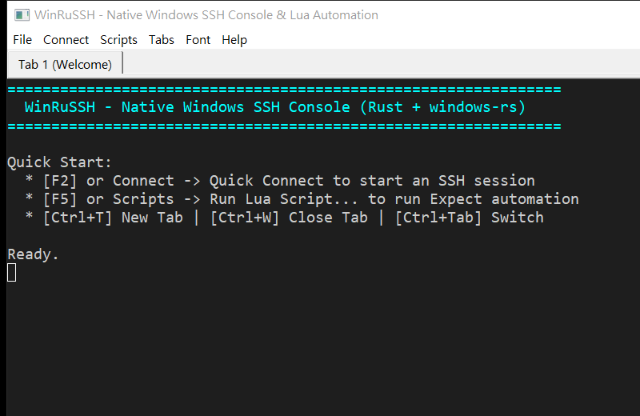

# WinRuSSH — Native Windows SSH Console & Lua Automation

**English** | [繁體中文](README.zh-TW.md)

An ultra-lightweight, high-performance native Windows SSH terminal emulator and automation console written in **Rust** using Microsoft's official **`windows-rs`** (`windows` 0.62), **`ssh2`** (libssh2), and embedded **Lua 5.4 (`mlua`)**.



---

## Key Highlights

- **Native Win32 GUI**: Built with `windows-rs`, supporting High-DPI v2 & ClearType, preserving terminal buffer text across window minimize/resize, and trimming unused trailing blank rows when shrinking.
- **Multi-Task Tabs**: Supports multiple concurrent SSH tabs and Lua script tasks.
- **Quick Connect (`F2`)**: Remembers last connection settings, with interactive login prompts and `known_hosts` fingerprint verification.
- **Lua Automation Engine**: Run `.lua` scripts with zero compilation, supporting `ssh.connect`, `ssh.expect`, `ssh.send`, `ssh.sleep`, and `ssh.read`.
- **Simultaneous Manual & Script Control**: Manual keyboard input is forwarded alongside Lua script execution and stays interactive after the script finishes.

---

## Hotkeys & Controls

| Shortcut / Action | Function |
| :--- | :--- |
| **`Mouse Left Drag`** | **Drag to select text (High-contrast Classic Blue Selection)** |
| **`Mouse Right Click`**| **Open context menu: Copy / Paste / Start or Stop Tab Log** |
| **`Ctrl + C`** | **Copy selected text to clipboard** if text is selected; otherwise send terminal interrupt (`SIGINT`) |
| **`Ctrl + V`** / **`Shift + Insert`** | **Paste text from system clipboard to terminal** |
| **`Ctrl + +` / `Ctrl + =`** | **Zoom In font size** |
| **`Ctrl + -`** | **Zoom Out font size** |
| **`Ctrl + 0`** | **Reset font size to default (16px)** |
| **`F2`** | Open Quick Connect dialog (Host, Port, Username, Password with Tab navigation & memory) |
| **`F5`** | Open and run a Lua automation script (`.lua`) |
| **`Ctrl + T`** | Create New Tab |
| **`Ctrl + W`** | Close current Tab |
| **`Ctrl + Tab`** | Switch to next Tab |
| **`Ctrl + Shift + Tab`** | Switch to previous Tab |
| **`Mouse Wheel`** | Scroll through terminal scrollback history |

---

## Writing Automation Scripts (`.lua`)

Scripts are standard plain-text Lua files. No compilation required.

```lua
-- example.lua
print("==================================================")
print("  WinRuSSH Lua Automation Demo")
print("==================================================")

local target = {
    host = "192.168.1.100",
    port = 22,
    username = "admin",
    password = "secret_password",
}

print(string.format("Connecting to %s:%d as %s...", target.host, target.port, target.username))
local ok, err = ssh.connect(target)

if not ok then
    print("[Error] Failed: " .. tostring(err))
    return
end

print("Connected! Waiting for prompt...")
if ssh.expect("$", 5000) or ssh.expect("#", 5000) then
    print("Sending inspect command: uname -a")
    ssh.send("uname -a\n")
    ssh.expect("$", 3000)

    print("Pausing 2s - you can type with the keyboard anytime...")
    ssh.sleep(2000)

    print("Back in Lua script! Performing cleanup...")
    ssh.send("exit\n")
end

print("Automation script complete.")
```

### Launching from the Command Line

```bat
winrussh.exe [--script] <script.lua> [args...]

winrussh.exe scripts\rebex_test.lua
winrussh.exe scripts\rebex_test_arg.lua demo password
winrussh.exe scripts\select_file_login_send_cmd.lua
```

A new `Lua: <name>` tab opens and runs the script. Inside Lua, `arg[0]` is the script path and `arg[1..]` are the extra arguments.

### Bundled Scripts (`scripts/`)

| Script | Usage |
| :--- | :--- |
| `rebex_test.lua` | Logs in to `test.rebex.net` (demo/password) and runs `dir` and `ls`. No arguments. |
| `rebex_test_arg.lua` | Same as above, but credentials come from arguments: `arg[1]` = username, `arg[2]` = password. |
| `select_file_login_send_cmd.lua` | Opens a PowerShell file dialog to pick a command `.txt`, logs in to `test.rebex.net`, then sends the file one line per `$` prompt. |
| `multi_prompt_demo.lua` | Demo of waiting on multiple prompts with `ssh.expect({...})`. |
| `watch_readme.lua` | Watches output in a loop: sends `OK` whenever `readme` appears, or sends Enter every 20 seconds. Optional args: `[host] [port] [username] [password]`. |

### Lua SSH Module Reference
- `ssh.connect({ host, port, username, password, key_path, passphrase, accept_new })`: Establish an SSH connection.
  - `accept_new` (optional boolean, default `false`): When `true`, automatically trusts and saves an unknown host key to `known_hosts` on first connection (host key mismatches are always rejected). When `false`, unknown hosts must be trusted interactively first.
- `ssh.send(string)`: Send a command string (including `\n`).
- `ssh.expect(pattern_or_table, timeout_ms)`:
  - Supports a single string (e.g., `"$"`) or a table of multiple candidate prompts (e.g., `{"$", "#", ">", "Password:"}`).
  - Returns: `(match_index, captured_text, matched_pattern)`
    - `match_index`: 1-based index of the matched prompt (`1, 2, 3...`, or `nil` on timeout).
    - `captured_text`: **All output text received between the previous prompt and this matched prompt**.
    - `matched_pattern`: The exact prompt string that matched.
- `ssh.read(timeout_ms)`: Read currently accumulated output.
- `ssh.sleep(ms)`: Pause execution for the specified milliseconds (manual keyboard input and remote output continue forwarding).

---

## Building from Source

### Prerequisites
- Windows 10 or Windows 11 (x86_64)
- Rust toolchain (`rustup install stable`)
- Visual Studio C++ Build Tools (MSVC)

### Build Commands
```bash
# Debug build
cargo build

# Optimized release build (size ~0.72 MB)
cargo build --release
```
The compiled executable will be located at `target\release\winrussh.exe`.
